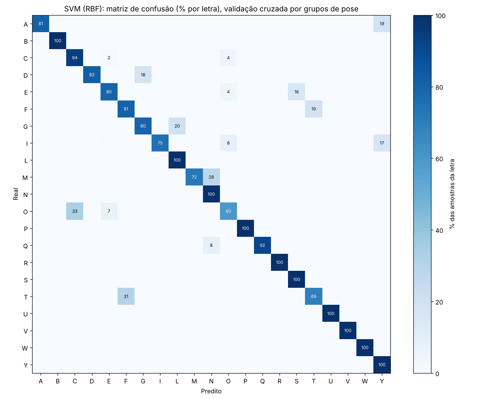

# 🤟 HandSpeak — Reconhecimento do alfabeto de Libras com visão computacional

Reconhece letras estáticas do alfabeto da Língua Brasileira de Sinais (Libras) a partir de imagens ou da webcam. O **MediaPipe Hand Landmarker** extrai 21 pontos da mão (x, y, z); os pontos são centralizados e normalizados, e um classificador do **scikit-learn** prevê a letra. Na webcam, letras estáveis são juntadas para formar palavras.

**Autores:** Felipe Vasconcellos e Katarine Melo.

---

## Como funciona

```
imagem/webcam ──► MediaPipe (21 landmarks) ──► normalização (centro da mão, escala) ──► classificador ──► letra
```

1. **Base de dados** — imagens rotuladas por letra (ver [Base de dados](#base-de-dados)), guardadas no Supabase (Storage + Postgres). `src/processing/extract_landmarks_from_db.py` baixa as imagens, deixa cada uma quadrada, extrai os landmarks e grava `data/processed/landmarks.csv`.
2. **Treino** — `src/training/train_landmarks_classifier.py` compara Random Forest, KNN, SVM e MLP e salva o melhor em `models/landmarks_classifier.pkl`.
3. **Predição** — `src/prediction/predict_image.py` (imagem) e `src/prediction/predict_image_cam.py` (webcam em tempo real).

A mesma normalização (`src/utils/normalization.py`) é usada no treino e na predição.

## Resultados

21 letras estáticas: A B C D E F G I L M N O P Q R S T U V W Y. As letras com movimento (H, J, K, X, Z) e os números ficaram de fora por falta de amostras.

A base tem muitos quadros repetidos ou quase idênticos, porque as imagens foram capturadas em sequência pela webcam. Por isso a avaliação:

- remove as **3.854 linhas duplicadas** (ficam 27.855 amostras);
- agrupa as amostras de cada letra por semelhança de pose (k-means, 10 grupos por letra);
- faz **validação cruzada em 5 partes deixando grupos inteiros de fora**, de modo que o teste só tem poses que o modelo não viu.

| Modelo | Acurácia | F1 macro |
|---|---:|---:|
| **SVM (RBF)** | **0,884 ± 0,072** | **0,875 ± 0,073** |
| Random Forest | 0,871 ± 0,059 | 0,870 ± 0,046 |
| MLP | 0,870 ± 0,076 | 0,860 ± 0,067 |
| KNN | 0,849 ± 0,084 | 0,851 ± 0,079 |

*Média ± desvio padrão nas 5 partes.* SVM, Random Forest e MLP ficam próximos, dentro da variação entre as partes. As confusões mais comuns são entre letras de formato parecido: M→N, O→C e T→F.



> Com uma separação aleatória comum, a acurácia passa de 99,8%. Esse número é otimista: quase toda amostra de teste tem uma quase-cópia no treino. Detalhes em [`reports/metrics.md`](reports/metrics.md).

**Limitações:** sem informação de quem sinalizou cada imagem, não dá para medir o desempenho em uma pessoa totalmente nova. Os resultados acima são uma estimativa para poses novas, e uma avaliação com sinalizadores separados seria o próximo passo.

## Base de dados

As imagens vêm da pasta `dataset/training` do repositório público [cnn-libras](https://github.com/lucaaslb/cnn-libras), de Lucas Lacerda (2020): 34.714 imagens RGB de 64×64 pixels das 21 letras estáticas do alfabeto de Libras, cerca de 1.650 por letra. O repositório não traz licença explícita; os direitos sobre as imagens são do autor original.

As imagens foram capturadas em sequência pela webcam, recortando sempre a mesma região do quadro. Por isso há muitos quadros quase idênticos, o que motiva a avaliação por grupos de pose descrita em [Resultados](#resultados).

## Estrutura

```
.
├── data/processed/
│   ├── landmarks.csv              # landmarks extraídos + rótulo
│   └── landmarked_images/         # imagens anotadas com os pontos da mão
├── models/
│   ├── hand_landmarker.task       # modelo do MediaPipe
│   └── landmarks_classifier.pkl   # classificador treinado
├── reports/                       # métricas e matriz de confusão
├── scripts/supabase/              # upload das imagens para o Supabase
├── src/
│   ├── processing/extract_landmarks_from_db.py
│   ├── training/train_landmarks_classifier.py
│   ├── prediction/predict_image.py
│   ├── prediction/predict_image_cam.py
│   └── utils/normalization.py
├── dockerfile
├── requirements.txt
└── .env.example
```

## Como executar

Requer **Python 3.10 a 3.12**.

```bash
pip install -r requirements.txt

# Treinar e gerar as métricas (usa data/processed/landmarks.csv)
python src/training/train_landmarks_classifier.py

# Prever uma imagem (ajuste o caminho no fim do script)
python src/prediction/predict_image.py

# Webcam em tempo real
python src/prediction/predict_image_cam.py
```

Para recriar a base a partir do Supabase, copie `.env.example` para `.env`, preencha com as suas credenciais e rode `python src/processing/extract_landmarks_from_db.py`.

### Docker

```bash
docker build -t handspeak .
docker run --rm -it --device=/dev/video0 -e DISPLAY=$DISPLAY -v /tmp/.X11-unix:/tmp/.X11-unix handspeak
```

Em Linux, rode `xhost +local:root` antes para liberar a janela. No Windows e no macOS, o acesso à webcam dentro do Docker é limitado; prefira rodar localmente.

## Tecnologias

Python · MediaPipe · OpenCV · scikit-learn · NumPy · pandas · Matplotlib · Supabase · Docker

## Licença

O código está sob a licença MIT — veja [LICENSE](LICENSE). As imagens de treino e os landmarks derivados delas vêm do repositório [cnn-libras](https://github.com/lucaaslb/cnn-libras) e não estão cobertos por essa licença; os direitos são do autor original.
